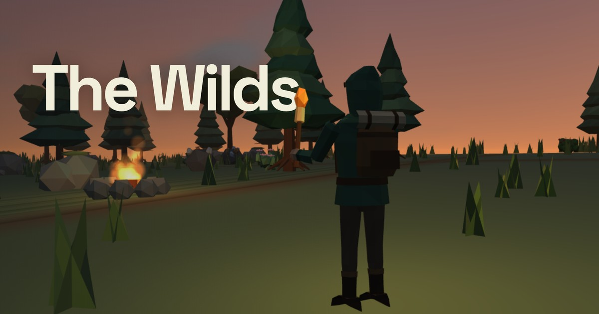
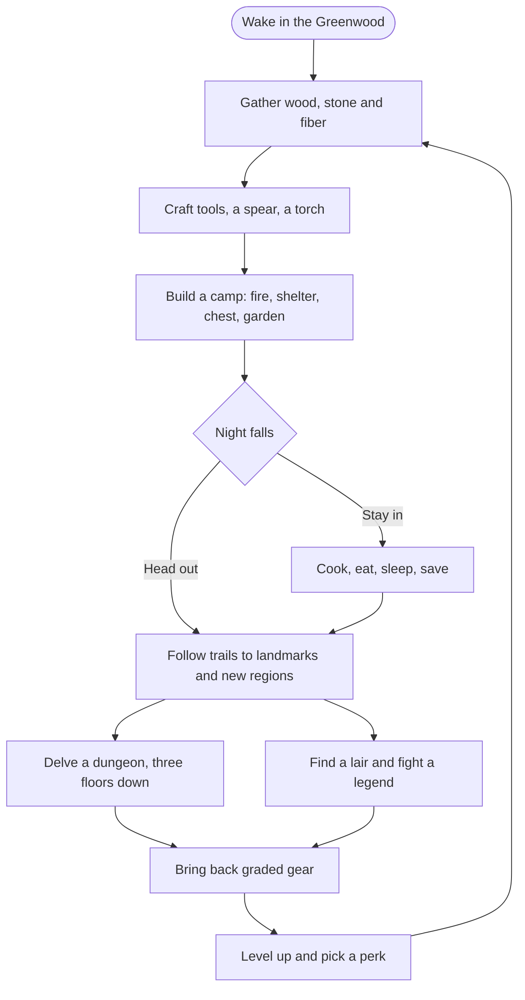
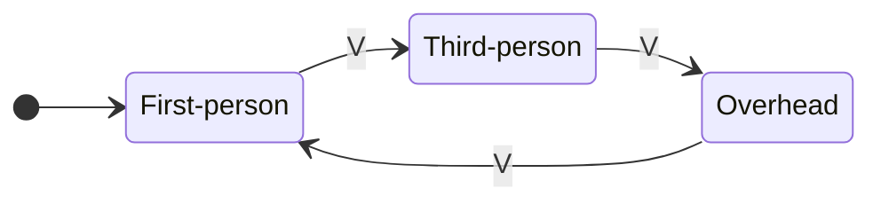
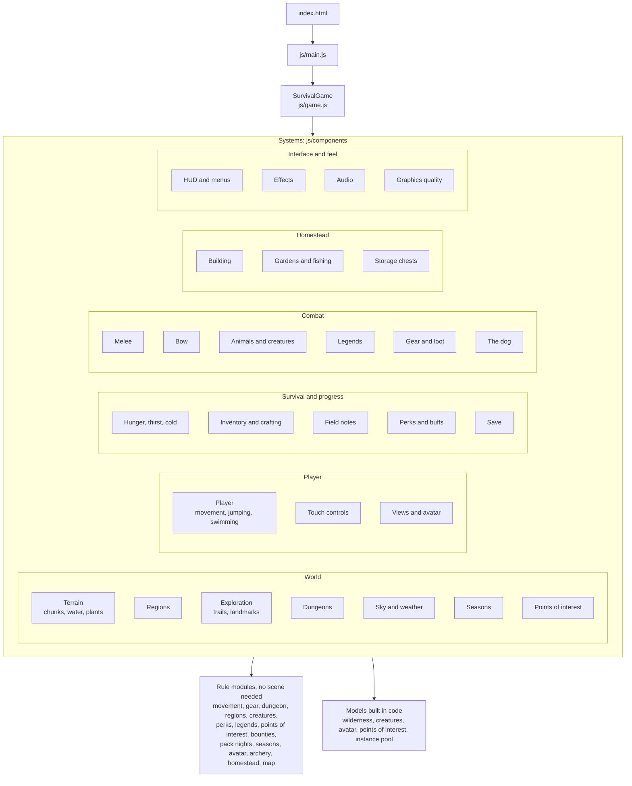
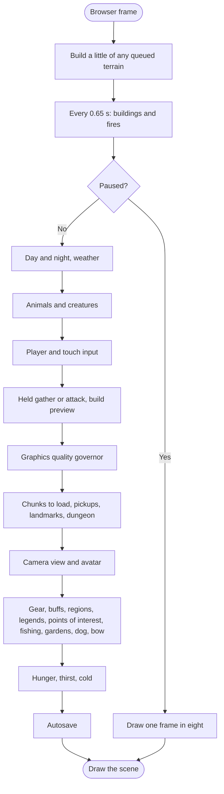
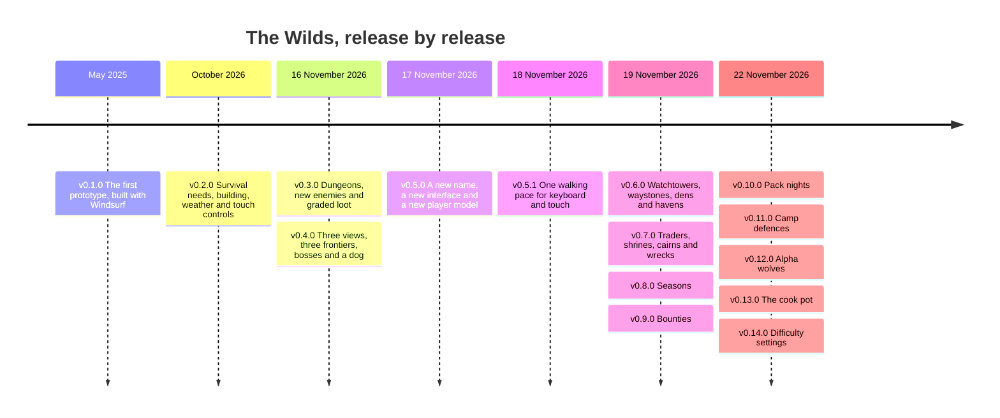

# The Wilds

[](https://github.com/CptNope/Survival-Game/actions/workflows/checks.yml)
[](CHANGELOG.md)
[](LICENSE)
[](https://cptnope.itch.io/survival-game-web-demo)
[](https://cptnope.itch.io/survival-game-web-demo/donate)

[](https://cptnope.itch.io/survival-game-web-demo)

A free 3D survival game that runs in the browser, built with Babylon.js. You
wake in a meadow with nothing. Gather, craft and build a camp, explore four
procedural regions full of places to find, from watchtowers and waystones to
traders and wrecks, hunt three legends, and delve generated dungeons for gear graded from Common to
Legendary. It plays with a keyboard and mouse or on a
touch screen, and installs as an app.

> **Play it now:** [on itch.io](https://cptnope.itch.io/survival-game-web-demo)
> or [on GitHub Pages](https://cptnope.github.io/Survival-Game/). Nothing to
> install and no account needed.
>
> **Enjoying it?** The game is free and open source. You can
> [support it with a donation on itch.io](https://cptnope.itch.io/survival-game-web-demo/donate).

## Contents

- [Links](#links)
- [About](#about)
- [How a session goes](#how-a-session-goes)
- [What is in the game](#what-is-in-the-game)
- [The world](#the-world)
- [Gear, perks and tonics](#gear-perks-and-tonics)
- [Building and crafting](#building-and-crafting)
- [Controls](#controls)
- [How it is built](#how-it-is-built)
- [Project layout](#project-layout)
- [Run it yourself](#run-it-yourself)
- [Tests and checks](#tests-and-checks)
- [Release history](#release-history)
- [Support the project](#support-the-project)
- [Getting help](#getting-help)
- [Contributing](#contributing)
- [License](#license)
- [Update notes](#update-notes)

## Links

| | Link | What it is |
| --- | --- | --- |
| **Play** | [cptnope.itch.io/survival-game-web-demo](https://cptnope.itch.io/survival-game-web-demo) | The game on itch.io, with comments and the devlog |
| **Play** | [cptnope.github.io/Survival-Game](https://cptnope.github.io/Survival-Game/) | The same build on GitHub Pages, deployed from `main`. The path is case-sensitive: the lowercase `/survival-game/` URL does not work |
| **Donate** | [Support This Game on itch.io](https://cptnope.itch.io/survival-game-web-demo/donate) | Pay what you like through itch.io, by card or PayPal |
| **Devlog** | [The Wilds devlog](https://cptnope.itch.io/survival-game-web-demo/devlog) | One post per release, from the first prototype on |
| **Changelog** | [CHANGELOG.md](CHANGELOG.md) | Every release and the pull requests in it |
| **Project page** | [jeremyanderson.tech/project/babylon-js-survival-game](https://jeremyanderson.tech/project/babylon-js-survival-game/) | Overview, screenshots and how it is built |
| **Build story** | [Vibe Coding a Babylon.js Survival Game](https://jeremyanderson.tech/vibe-coding-a-babylon-js-survival-game/) | The write-up: from a Windsurf prototype to The Wilds with Claude Fable |
| **Source** | [github.com/CptNope/Survival-Game](https://github.com/CptNope/Survival-Game) | This repository |
| **Issues** | [Report a bug or suggest something](https://github.com/CptNope/Survival-Game/issues) | The issue tracker |
| **Pull requests** | [Merged and open pull requests](https://github.com/CptNope/Survival-Game/pulls?q=is%3Apr) | How every change went in, with its notes |
| **Checks** | [GitHub Actions](https://github.com/CptNope/Survival-Game/actions) | Unit tests and a real-browser startup check on every change to the game |
| **Help** | [SUPPORT.md](SUPPORT.md) or [info@jeremyanderson.tech](mailto:info@jeremyanderson.tech) | Where to ask when something goes wrong |
| **Model workshop** | [models.html](https://cptnope.github.io/Survival-Game/models.html) | The low-poly wilderness models on their own |
| **Resource field guide** | [resources.html](https://cptnope.github.io/Survival-Game/resources.html) | What can be gathered and what it makes |
| **Engine** | [babylonjs.com](https://www.babylonjs.com/) | The 3D engine the game runs on |

The maker:

| | Link |
| --- | --- |
| **Website** | [jeremyanderson.tech](https://jeremyanderson.tech/) |
| **Services** | [jeremyanderson.tech/services](https://jeremyanderson.tech/services/) |
| **More projects** | [jeremyanderson.tech/projects](https://jeremyanderson.tech/projects/) |
| **Blog** | [jeremyanderson.tech/blog](https://jeremyanderson.tech/blog/) |
| **Book a call** | [jeremyanderson.tech/book-a-call](https://jeremyanderson.tech/book-a-call/) |
| **itch.io** | [cptnope.itch.io](https://cptnope.itch.io/) |
| **GitHub** | [github.com/CptNope](https://github.com/CptNope) |
| **X** | [@JAndersonTech](https://x.com/JAndersonTech) |
| **YouTube** | [@JeremyAndersonTech](https://www.youtube.com/@JeremyAndersonTech) |
| **LinkedIn** | [Jeremy Anderson Tech](https://www.linkedin.com/company/jeremyanderson-tech/) |
| **Email** | [info@jeremyanderson.tech](mailto:info@jeremyanderson.tech) |

## About

The Wilds is made by [Jeremy Anderson Tech](https://jeremyanderson.tech/), a
web development and security practice in Shrewsbury, MA.

It began on 9 May 2025 as a prototype called Survival Game, built with
Windsurf, an AI coding tool, to see how far a 3D browser game could get with
Babylon.js: Perlin-noise terrain, trees and rocks to harvest, a few animals
and a crafting panel. It then sat untouched for more than a year.

Work started again in late October 2026 with survival needs, building,
weather and touch controls. Since 16 November 2026 it has been built with
Claude Fable working as a coding agent: each change arrives as a pull request
with unit tests and a headless-browser playthrough, and is merged after
review. That is where the dungeons, graded gear, three camera views, frontier
regions, legends, the dog, the rebuilt interface and the explorer model came
from. The game took its name, The Wilds, in November 2026.

It is free to play, has no ads and no accounts, and keeps your save in your
own browser. The code is open source under the MIT license.

## How a session goes



Hunger, thirst and cold tick the whole time. A day lasts five minutes, wolves
come out at night, and each region beyond the meadow adds its own pressure. A
year lasts twelve days, an hour of play, and its fourth season is winter.

## What is in the game

| Area | What you get |
| --- | --- |
| **Survival** | Health, hunger, thirst and cold. Eat, drink at a lake or from a waterskin, and warm up at a fire or under a roof. Sleep through the night in a shelter |
| **Gathering** | Trees, rocks, iron ore, fiber plants, herbs, berries, mushrooms and cactus fruit. Gathered nodes stay gathered and grow back over days |
| **Crafting** | 28 recipes: planks, stone and iron tools, a spear, a torch, a waterskin, a fishing rod, a bow and arrows, a fur cloak, remedies, cooked food, three tonics and three stews |
| **Difficulty** | Gentle, Standard or Harsh, chosen on the menu and changeable at any time |
| **Cooking** | A cook pot makes stews two servings at a time. Carry them and eat them when you need a full meal and a five-minute effect |
| **Building** | A lean-to, a campfire, floors, walls and roofs that snap together, garden beds and storage chests, with a preview before you place |
| **Combat** | Tools, spear and bow. Every enemy attack has a wind-up you can see. A dodge with a moment of safety, a heavy sweep, and a quick heal |
| **Exploration** | Trails, landmarks, a field compass and a map. Four regions that blend into each other, each with its own weather, plants and hunters |
| **Points of interest** | Watchtowers that put the country around them on your map, waystones to travel between, dens to clear, a haven in every region, traders to barter with, shrines, cairns whose notes lead to buried caches, and wrecks to dive on |
| **Dungeons** | Stone doorways lead to three generated floors of rooms, corridors, traps, shrines and chests, with a boss at the bottom. Layouts redraw every three days |
| **Loot** | Found weapons, armor, boots and charms with rolled bonuses, graded Common to Legendary. Compare, equip or break them down |
| **Progression** | Experience and levels, a perk to choose at each level, and field notes that teach the game one goal at a time |
| **Legends** | Three great beasts, one in each frontier region, each with a lair and a named legendary prize |
| **Homestead** | Fishing, garden beds that grow four crops, and chests to store what you cannot carry |
| **Companion** | A stray dog to tame with cooked meat. It follows, fights beside you, and can be told to stay |
| **Views** | First-person, third-person and overhead cameras, with a jointed explorer who walks, sprints, swims, swings and draws a bow |
| **Bounties** | Notice boards at traders and watchtowers post jobs: hunt the region's hunters, deliver what it is short of, or clear a den. Come back to the board for a piece of gear |
| **Camp defences** | Spike traps, palisades and watch fires, which work on everything that hunts you |
| **Pack nights** | On the last night of every season a pack hunts you at midnight. Break it for gear, outlast it until dawn, or lose it |
| **Seasons** | Spring, summer, autumn and winter, three days each. The land changes colour, the weather and the cold change with it, and each season gives or takes something |
| **World feel** | A day and night sky, rain, storms and snow, swimmable lakes, and sound made in code |
| **Any screen** | An interface that scales from a small phone to a 4K monitor, touch controls, and a Graphics setting with an automatic mode |
| **Offline** | Installs as an app and plays offline once it has loaded online at least once. Saves live in your browser |

## The world

Everything within about 170 m of the starting clearing is the Greenwood.
Beyond it the country is one of four regions, blending across each border.

| Region | Where | What it does to you | What grows | What hunts |
| --- | --- | --- | --- | --- |
| **The Greenwood** (meadow) | Home | Nothing | Pine, oak, berries | Wolves at night |
| **Frostfell** (snow) | About 360 m south | Cold builds even at noon | Snowy pines | Ice wolves; a bite adds cold |
| **Sunscar** (desert) | About 240 m north-west | Thirst builds about twice as fast by day | Cactus, deadwood | Scorpions; a sting poisons |
| **Mirefen** (marsh) | About 360 m west | Thick fog | Bog trees, mushrooms | Bog toads that spit from range |

### Seasons

A year is twelve days: four seasons of three days each, starting with spring
on day 1. The clock at the top of the screen names the season, and the map
says how long is left of it. Dawn announces a new season, and gives a day's
warning of the next.

| Season | Days | What it does | The skies |
| --- | --- | --- | --- |
| **Spring** | 1 to 3 | Garden beds grow half as fast again, and gathered plants grow back in half the time | Wet: more rain than any other season, few storms |
| **Summer** | 4 to 6 | Nights are milder (the night chill is 30% weaker), and thirst builds a fifth faster by day | Mostly clear |
| **Autumn** | 7 to 9 | One more from every berry bush, herb, mushroom, fiber plant, cactus and garden bed | Rain and the most storms |
| **Winter** | 10 to 12 | Cold builds even at noon. Gathered plants do not grow back until spring, and beds grow at a quarter of their pace. One more cut of meat from anything hunted | Snow, and blizzards for storms |

The Greenwood and Mirefen change colour with the season: oaks blossom, turn
red and gold, and stand white; pines take snow on their boughs; the ground
goes from green to straw to snow. The change comes over a season's first
morning. Frostfell is white all year and its rain always falls as snow.
Sunscar stays sand, feels a quarter of the winter chill, and gets cold rain
instead of snow.

Nothing about the season is saved. It is worked out from the day count, so an
expedition begun before this update finds itself wherever its day falls.

### Points of interest

They come in two layers, so the country is never empty for long: a watchtower,
waystone, den or haven in about three of every four 160 m squares, and a
trader, shrine or cairn in about two of every three 220 m squares. Most lakes
hold a wreck. Walk up to one and it goes on your map.

| Place | What it does |
| --- | --- |
| **Watchtower** | Climb it (**E**) to mark what lies around on your map: landmarks within 160 m, ways underground and other places within 320 m. They show as hollow marks until you reach them |
| **Waystone** | Wake it (**E**). From any woken waystone you can step to any other. The Clearing Waystone, a short walk from where you start, is the way home |
| **Den** | Three of the region's hunters come out when you get close: boars, ice wolves, scorpions or toads, led by an elite far from home. Kill them all for a piece of gear and their hoard. It is lived in again four days later |
| **Haven** | Once a day it gives what its region takes. An old orchard feeds you, a hot spring clears the cold and warms you, an oasis slakes you and fills a waterskin, and a stilt hut cures venom and guards against it |
| **Trader** | Press **E** to see the board: three swaps and one piece of gear, priced in what the region is short of. Each swap can be had twice a day and the board changes every morning |
| **Shrine** | To the boar, the tortoise or the hare. Pray (**E**) once a day for four minutes of fury, stoneskin or swiftness |
| **Cairn** | Read the note under it (**E**). It gives a distance and a direction and marks your map; walk there, find the crossed sticks and dig (**E**) for a piece of gear and supplies |
| **Wreck** | A mast standing out of a lake. Swim over, dive (**Ctrl**) and prise open the chest on the deck (**E**) for a piece of gear that is never common |

### Bounties

Every trader and every watchtower has a notice board with one job on it. The
job stays up for three days, then a new one is posted.

| Job | What it asks | How it is done |
| --- | --- | --- |
| **Hunt** | Three to six of the region's hunters: wolves or boars, ice wolves, scorpions or bog toads | Kill them anywhere, including the ones that come out of a den |
| **Delivery** | Something the region is short of, such as 4 raw fish or 3 pelts. Traders only | Have it in your pack when you come back |
| **Den** | A den within 450 m of the board, cleared out. It is marked on your map when you take the job | Clear it after taking the job |

Take a job at the board (**E** at a trader; at a watchtower the notice shows
after you have looked around), do it, and go back to the same board to be
paid: a piece of gear a level above the country you are in, and experience.
You can have three jobs in hand at once, and the map lists them.

### Camp defences

Three things to build that work on whatever hunts you: wolves, boars, bears
and every frontier creature above ground. Deer and rabbits are left alone.

| Piece | What it does | How long it lasts |
| --- | --- | --- |
| **Spike trap** | 14 damage and a half-second stagger to a hunter standing on it, once a second | Breaks after 10 catches |
| **Palisade** | A four-metre fence of sharpened logs. Hunters cannot cross it, and neither can you | One hunter tears it down in 30 seconds; three in 10 |
| **Watch fire** | Hunters within 9 m move at 70% of their pace. Warm to stand by, like a campfire | Does not wear out |

Palisades join up on the same four-metre grid as walls. Traps and watch
fires are small: they can stand 2.5 m from anything, where other structures
need 7 m. A hunter goes straight for you, so a fence between you and it
holds it there, and a trap in front of the fence catches it while it pushes.

### Pack nights

On the last night of every season (days 3, 6, 9, 12 and so on) a pack comes
for you. You are warned at dusk, and it arrives at midnight, in a ring around
wherever you are standing above ground.

| | |
| --- | --- |
| **Who comes** | The region's own hunters: wolves in the Greenwood, ice wolves in Frostfell, scorpions in Sunscar, bog toads in Mirefen |
| **How many** | Three on the first pack night, one more each season up to seven, and one more again in winter |
| **How strong** | They toughen as the seasons pass, and from the second pack night one of them is an elite leader: in the Greenwood, an alpha wolf |
| **Break it** | Kill them all for a piece of gear a level above the pack, the region's spoils and experience |
| **Outlast it** | Whatever is left gives up at dawn, for a little experience and no gear |
| **Lose it** | Get more than 100 m clear and the pack is gone. So is the reward |

There is no sleeping from the warning until the pack is dealt with. A pack on
the hunt keeps your scent from 60 m, much further than its kind usually sees.
If you are underground at midnight the pack finds nobody and moves on. The map
says which night the next one comes.

### Creatures

| Creature | Where | How it behaves |
| --- | --- | --- |
| Deer, rabbit | The Greenwood | Graze, and run when you come close. Hunt them for meat |
| Wolf | The surface, at night | Hunts you in the dark. From the fourth day, now and then one is an alpha: larger, black-coated and carrying gear |
| Boar | The surface, by day | Leaves you alone until you come close, then charges |
| Bear | The surface, far from camp | Rare and dangerous; always drops a piece of gear |
| Ice wolf | Frostfell | Fast; its bite chills |
| Scorpion | Sunscar | Lunges, and its sting poisons |
| Bog toad | Mirefen | Keeps its distance and spits |
| Cave spider | Dungeons | Fast and fragile; lunges from a few metres away |
| Bat | Dungeons | Weaves through the air, bites and retreats |
| Skeleton | Dungeons | Walks you down and swings |
| Wraith | Dungeons, floors 2 and 3 | Keeps its distance and throws bolts down corridors |
| Slime | Dungeons, any floor | Slow and sturdy; splits into two quick slimelets when it dies |
| Mimic | Dungeons, floors 2 and 3 | Looks like a chest until you open it; always drops gear when beaten |
| Stone Warden | Dungeons, floor 3 | Boss. A slow, telegraphed slam; enrages and calls spiders at half health |

### Legends

| Legend | Region | How it fights | Prize |
| --- | --- | --- | --- |
| **Old Rime**, the white alpha | Frostfell | A huge ice wolf; its bite chills, and it calls ice wolves as it weakens | Rime's Fang (weapon) |
| **The Sand Tyrant**, king of scorpions | Sunscar | A huge scorpion that lunges and poisons, and calls scorpions at half health | Tyrant's Carapace (armor) |
| **Mother of the Mire**, the great toad | Mirefen | A huge toad that keeps its distance and spits three bolts in a fan | Mirewalkers (boots) |

Each legend is killed once, and its prize is always legendary.

## Gear, perks and tonics

Found gear rolls its bonuses when it drops. The total decides its grade.

| Grade | Colour |
| --- | --- |
| Common | Grey-green |
| Uncommon | Green |
| Rare | Blue |
| Epic | Purple |
| Legendary | Gold |

Bonuses a piece can carry: damage, critical chance, swing speed, health per
hit, max health, damage reduction, cold resistance, slower hunger and thirst,
move speed and bonus experience.

| Perk | What a rank gives | Ranks |
| --- | --- | --- |
| Brawler | +12% damage with tools and spears | 3 |
| Marksman | +15% damage with the bow | 3 |
| Tough | +20 maximum health | 3 |
| Fleet | +6% movement speed | 3 |
| Hardy | Hunger and thirst build 15% slower | 3 |
| Insulated | The cold builds 20% slower | 2 |
| Forager | 20% chance of an extra item when gathering | 3 |
| Fletcher | 25% of loosed arrows are not used up | 2 |
| Acrobat | Dodge is ready 20% sooner | 2 |
| Field medic | Remedies heal 25% more | 2 |
| Treasure hunter | Dropped gear rolls better | 2 |

You earn one perk point per level after the first, and choose from three
perks each time.

| Tonic | Made from | Where | Effect |
| --- | --- | --- | --- |
| Warming draught | 2 mushrooms, 1 herb | Campfire | The cold builds 60% slower for 3 minutes |
| Antivenom | 1 cactus fruit, 2 herbs | Anywhere | Cures venom, and immunity for 2½ minutes |
| Hunter's broth | 1 fish, 2 berries | Campfire | 30 hunger and +30% damage for 2 minutes |

Stews are cooked in a cook pot, two servings at a time, and carried. A serving
is eaten anywhere: a full meal and an effect milder than a tonic's but much
longer.

| Stew | One pot takes | A serving gives |
| --- | --- | --- |
| Hunter's stew | 2 raw meat, 1 mushroom, 1 herb | 60 hunger, 20 health, and +15% damage with 15% less damage taken for 5 minutes |
| Fish chowder | 2 raw fish, 2 berries, 1 herb | 50 hunger, 15 health, and +15% move and swing speed for 5 minutes |
| Winter pottage | 3 mushrooms, 2 berries | 45 hunger, and the cold builds 70% slower for 6 minutes |

## Difficulty

The menu has a difficulty setting next to sound and graphics. It is kept with
your other device settings, not in the expedition, and you can change it at
any time; it applies from that moment.

| | Gentle | Standard | Harsh |
| --- | --- | --- | --- |
| A blow from anything that attacks | 40% less | as made | 40% more |
| Hunger, thirst and the cold | build 30% slower | as made | build a quarter faster |
| Pack nights | one fewer, never under two | as made | one more |
| Alpha wolves on ordinary nights | none | from day 4 | from day 4 |

Starvation, thirst, the cold, drowning, falls and venom do the same harm at
every level: the setting changes how fast you get there, not what it does.
Warming up by a fire is never slowed.

## Building and crafting

| Piece | Cost | What it is for |
| --- | --- | --- |
| Lean-to shelter | 6 wood, 2 planks, 3 fiber | Somewhere to rest through the night |
| Campfire | 3 wood, 3 stone | Warmth, light and cooking |
| Wooden floor | 2 planks | The base of a cabin; pieces snap together |
| Log wall | 4 wood | The sides of a cabin |
| Wooden roof | 3 planks, 2 fiber | The top of a cabin |
| Garden bed | 4 wood, 2 fiber | Grows berries, herbs, mushrooms or cactus fruit |
| Storage chest | 4 planks, 2 fiber | Holds what you cannot carry |
| Spike trap | 4 wood, 1 fiber | Hurts and staggers whatever hunts you; breaks after 10 catches |
| Palisade | 6 wood | Stops hunters until they tear it down |
| Watch fire | 4 wood, 3 stone | Hunters within 9 m move at 70% of their pace; warmth |
| Cook pot | 4 stone, 3 wood, 1 iron ingot | Cooks stews; roasts and brews like a campfire; warmth |

Recipes are in the Craft menu (**C**), and the
[resource guide](https://cptnope.github.io/Survival-Game/resources.html) shows
what each material makes.

## Controls

### Keyboard and mouse

| Key | Action |
| --- | --- |
| **W A S D** | Move |
| **Mouse** | Look around |
| **Shift** | Sprint |
| **Click** (hold) | Gather or attack; cast a fishing line; confirm a build |
| **Right-click** | Heavy sweep; cancels building |
| **E** | Drink, sleep, open chests, plant, take doors and stairs; climb a watchtower, wake a waystone, use a haven |
| **Space** | Jump; double tap to fly, hold to rise |
| **Ctrl** | Descend while flying, or dive in deep water |
| **Q** | Dodge |
| **H** | Quick heal |
| **R** | Hold to draw the bow; rotates a build preview |
| **F** | Torch |
| **V** | Change view; the mouse wheel zooms the outside views |
| **T** | Dog: stay or follow |
| **C** / **B** / **G** | Craft, Build, Gear |
| **K** / **N** | Perks, Map |
| **M** / **P** | Mute, Save |
| **Esc** | Pause |

### Touch

| Control | Action |
| --- | --- |
| **Stick** | Move. Half a push is half the pace |
| **Drag** | Look around; pinch to zoom the outside views |
| **HIT** | Hold to gather or attack; tap to cast a line |
| **USE** | Drink, sleep, open chests, plant, take doors and stairs; climb a watchtower, wake a waystone, use a haven |
| **JUMP** | Jump; double tap to fly |
| **RUN** | Hold to sprint |
| **DODGE** | A short dash that blows miss |
| **HEAL** | Use your best remedy |
| **BOW** | Hold to draw, let go to loose |
| **TORCH** | Light or put away the torch |
| **SKILL** | Heavy sweep; cancels building |
| **DOWN** | Descend while flying, or dive |
| **View** | First-person, third-person or overhead |
| **Compass** | Tap for the map |

**V** steps through the three camera views in order:



## How it is built

| Part | Choice |
| --- | --- |
| **Engine** | [Babylon.js](https://www.babylonjs.com/), loaded from its CDN. Tests run against `babylonjs` 9.32.0 from npm |
| **Language** | Plain JavaScript as ES modules, with HTML and CSS. No framework and no build step |
| **Size** | About 12,600 lines of JavaScript in 64 modules |
| **Models** | Every tree, rock, creature and the explorer is low-poly geometry built in code. There are no model or texture downloads |
| **Sound** | Synthesised in the browser with the Web Audio API |
| **Saves** | `localStorage`, under `the-wilds-save-v1` and `the-wilds-settings-v1` |
| **Offline** | A service worker caches the game's own files and the engine |
| **Hosting** | GitHub Pages from `main`, and a zip of the same files on itch.io |
| **Checks** | 255 unit tests on Node's test runner, plus a startup check in real desktop and mobile Chrome, run by GitHub Actions |

### How the code is arranged

`js/game.js` creates one `SurvivalGame`, which owns about thirty systems. The
rules that can be worked out without a 3D scene (how gear is graded, how a
dungeon floor is laid out, how fast you walk) live in plain modules under
`js/`, so they can be unit tested on their own. The systems under
`js/components/` apply those rules to the scene.



### What happens in a frame



The HUD is refreshed every frame, paused or not. Time-based work uses the
frame's length in seconds, capped at 0.05 s, so a hitch is never read as a
leap. Walking is set in units a second (walk 6,
sprint 9.5) for keyboard and touch alike.

## Project layout

| Path | What is in it |
| --- | --- |
| `index.html`, `styles.css` | The page, the HUD and menu markup, and the whole interface stylesheet |
| `js/main.js`, `js/game.js` | Start-up and the `SurvivalGame` class that owns every system |
| `js/components/` | The systems: terrain, player, touch, view, survival, inventory, building, combat, archery, animals, creatures, dungeon, regions, legends, points of interest, companion, homestead, storage, gear, perks, buffs, progression, weather, sky, audio, effects, quality, save and the interface |
| `js/*.js` | Rule modules with no scene in them: `movement`, `gear`, `dungeon`, `regions`, `creatures`, `perks`, `legends`, `pois`, `bounties`, `raids`, `seasons`, `avatar`, `archery`, `companion`, `homestead`, `storage`, `map`, `view`, `quality`, `resources`, `settings` |
| `js/models/` | Models built in code: `wilderness`, `creatures`, `avatar`, `pois`, and the instance `pool` |
| `tests/` | 17 test files, one per area of the game |
| `scripts/browser-smoke.mjs` | Starts the game in real Chrome, desktop and emulated phone, and checks it reaches play |
| `sw.js`, `manifest.json`, `icons/` | The service worker, the app manifest and the install icons |
| `models.html`, `resources.html` | The model workshop and the resource field guide |
| `CHANGELOG.md`, `SUPPORT.md`, `LICENSE` | Release history, where to get help, and the MIT license |
| `.github/` | The checks workflow and the funding link |

## Run it yourself

The game is static files, so any local web server will do. It has to be
served over HTTP: opening `index.html` straight from disk will not load the
modules.

```bash
git clone https://github.com/CptNope/Survival-Game.git
cd Survival-Game
python -m http.server 8000      # or: npx serve
```

Then open `http://localhost:8000`. The engine comes from the Babylon.js CDN,
so the first load needs a connection.

## Tests and checks

```bash
npm ci
npm test
```

`npm test` runs 255 unit tests on Node's built-in test runner. They cover the
rule modules directly and drive the systems on Babylon's `NullEngine`, which
needs no browser or graphics card.

`node scripts/browser-smoke.mjs` starts the game in a real Chrome, on a
desktop page and an emulated phone, and fails if it does not reach play. It
needs Chrome installed; set `CHROME_BIN` to point at it.

Both run in GitHub Actions, as the `test` and `startup` jobs, on every pull
request and push to `main` that touches the game code, the tests or the
package files. See the [checks workflow](https://github.com/CptNope/Survival-Game/actions/workflows/checks.yml).

## Release history



| Version | Date | What it brought | Pull requests |
| --- | --- | --- | --- |
| **v0.14.0** | 22 Nov 2026 | Difficulty: Gentle, Standard and Harsh, on the menu and changeable at any time | 32 |
| **v0.13.0** | 22 Nov 2026 | The cook pot: three stews cooked two servings at a time, carried, and eaten for a long effect | 31 |
| **v0.12.0** | 22 Nov 2026 | Alpha wolves: wolves toughen by tier and have an elite form; the map is drawn in the season's colours | 30 |
| **v0.11.0** | 22 Nov 2026 | Camp defences: spike traps, palisades and watch fires; chests and garden beds lose a stray campfire | 29 |
| **v0.10.0** | 22 Nov 2026 | Pack nights: a hunting pack at midnight on the last night of every season | 28 |
| **v0.9.0** | 19 Nov 2026 | Bounties: jobs on notice boards at traders and watchtowers, paid in gear | 27 |
| **v0.8.0** | 19 Nov 2026 | Seasons: a twelve-day year that changes the land, the weather, the cold, the garden and what grows back | 26 |
| **v0.7.0** | 19 Nov 2026 | More places: traders to barter with, shrines, cairns with buried caches, and wrecks to dive on | 25 |
| **v0.6.0** | 19 Nov 2026 | Points of interest: watchtowers, waystones to travel between, dens and havens | 24 |
| **v0.5.1** | 18 Nov 2026 | One walking pace for keyboard and touch; the changelog; donation and help links | 20, 21 |
| **v0.5.0** | 17 Nov 2026 | The name The Wilds, an interface for every screen, a Graphics setting, and the explorer model | 18, 19 |
| **v0.4.0** | 16 Nov 2026 | Three camera views, a dodge, three frontier regions, a bow, perks, legends, a map, fishing, gardens, a dog, chests and tonics | 14 to 17 |
| **v0.3.0** | 16 Nov 2026 | Sound, a sky, swimming, field notes, generated dungeons, new enemies and graded gear | 12, 13 |
| **v0.2.0** | 28 Oct 2026 | Hunger, thirst and cold, shelters and saves, weather, modular building, wolves, cooking, landmarks, touch controls and tests | 1 to 11 |
| **v0.1.0** | 9 May 2025 | The first prototype: terrain, harvesting, crafting, animals, combat and flying | First commits |

The full list is in the [changelog](CHANGELOG.md), each release has a post in
the [devlog](https://cptnope.itch.io/survival-game-web-demo/devlog), and the
detailed notes for every update are [further down this page](#update-notes).

## Support the project

The Wilds is free to play and open source, with no ads. If you enjoy it:

- **[Donate on itch.io](https://cptnope.itch.io/survival-game-web-demo/donate).**
  Pay what you like, by card or PayPal. Any amount helps keep it growing.
- **Rate it or leave a comment** on the
  [itch.io page](https://cptnope.itch.io/survival-game-web-demo). It helps
  other players find the game.
- **Star this repository** and share the game with someone who would like it.
- **Need something like this built?** [Book a call](https://jeremyanderson.tech/book-a-call/)
  or see the [services](https://jeremyanderson.tech/services/) page.

## Getting help

Stuck, found a bug, or the game will not load? Email
[info@jeremyanderson.tech](mailto:info@jeremyanderson.tech) or
[open an issue](https://github.com/CptNope/Survival-Game/issues). Say which
browser and device you are on and what you were doing when it went wrong.
More in [SUPPORT.md](SUPPORT.md).

If you get the old version after an update, reload the page once: the game
caches itself for offline play.

## Contributing

Bug reports and ideas are welcome in the
[issue tracker](https://github.com/CptNope/Survival-Game/issues). If you send
a pull request, run `npm test` first, and add a test for anything you change
in a rule module. Changes go in through pull requests against `main`, and the
checks have to pass before a merge.

## License

[MIT](LICENSE). You can use, change and share the code, including in your own
projects, as long as the license notice stays with it.

## Update notes

Everything below is the detailed record of each update, oldest first, as it
was written at the time. Newer notes replace older ones where they disagree.

### Expedition update

The desktop interface now includes a pause screen, centered interaction reticle,
resource quick view, oxygen/health/XP meters, contextual gathering hints, and a
first-tool objective. Press **C** for field crafting and **Esc** to pause.
Click the canvas to capture the mouse; use Esc to release it. Losing focus pauses
simulation. The original optional virtual gamepad UI has been replaced by this
desktop-focused interface; a dedicated mobile control pass is still needed.

Recipes: 2 wood makes a plank; 1 plank + 2 stone makes a tool; 3 wood makes a
field dressing that immediately restores up to 30 health. Gathering and normal
attacks require a target within 5 units. Right click spends one tool on an area
attack. Night lighting, distance fog, evergreen trees, and fleeing wildlife add
atmosphere. Distant terrain now releases its associated resources and water.

Run regression tests with Node.js 22 or newer:

```sh
node --test tests/game.test.mjs
```

The world and inventory are session-only. CDN dependencies require an initial
online load; offline availability depends on successful service-worker caching.

### Wilderness models

Trees, rocks, deer, and dropped supplies are generated locally by
`js/models/wilderness.js`. The collection uses matte materials and per-face
colors, with seeded variation for trees and rocks. Pines have layered crowns,
branches and roots; broadleaf trees use branching trunks and clustered canopies.
Boulders include smaller stones and moss. Deer have a four-leg diagonal gait,
antlers, ears, eyes, and hooves. Dropped resources have item-specific silhouettes.

Open `models.html` on the same local server to orbit and inspect the collection.
The viewer uses studio lighting; the game uses its own day/night lighting and
camera-following shadow map. Static assets merge into one mesh each; deer use
five visible meshes to retain leg animation. No external model downloads are
needed. The first-person player remains invisible.

To run gameplay and real Babylon geometry tests:

```sh
npm ci --ignore-scripts
npm test
```

The pinned Babylon development dependency is test-only; the game still loads
its existing CDN engine. Tests cover geometry, deterministic variants, disposal,
canopy orientation, animation, and hits on nested deer meshes.

### Ore and foraging

Iron deposits, fiber plants, purple medicinal flowers, and red berry bushes now
populate dry terrain. A starter group appears just outside the spawn clearing.
Aim at the plant/deposit within five units and click; the reticle shows its type.
Ore requires a stone or iron tool in inventory (mining does not consume it).

- Iron deposits yield 2 ore, or 3 with an iron tool.
- Fiber plants yield 3 fiber; medicinal flowers yield 2 herbs; bushes yield 3 berries.
- 2 ore + 2 wood smelts into 1 iron ingot through field crafting.
- 2 ingots + 1 plank + 2 fiber crafts an iron tool (+8 normal attack damage).
- 2 fiber + 2 herbs restores up to 50 health; eating 2 berries restores up to 15.

Recipes are shared between the UI and inventory logic in `js/resources.js`.
Healing consumes nothing at full health. All new items drop on death and can be
recovered. Resource depletion is session/chunk-local, like the existing trees.
Open `resources.html` for an orbitable resource field guide. Run `npm test` for
gathering gates, crafting costs, healing, death drops, and asset cleanup tests.

### Responsive-world improvements

- Lower camera inertia for precise keyboard/mouse movement; hold **Shift** to sprint.
- Frame-time-clamped jumping, flight, and swimming without excessive vertical drift.
- Nearby deer visible from the start; wandering, grazing and water avoidance.
- Richer hills, deterministic resource placements, and resource depletion retained
  when crossing chunk boundaries during a session.
- Thin-instanced grass groundcover: many tufts with a single draw call per chunk.
- Share terrain/grass/water materials across chunks and cast fewer expensive shadows.
- Load the immediate 3×3 terrain chunks first and spread the outer ring over
  subsequent frames to avoid a long blocking startup.
- Drop unneeded Cannon physics and Babylon add-on downloads from the game page.
- Lower high-DPI rendering resolution on touch devices for smoother frame rates.

The game is still desktop-controlled and the world state is not saved across reloads.
No network assets or monetized systems were added by this improvement pass.

### Discoverable wilderness

Walk the dirt trails leading out of the spawn clearing to three persistent
landmarks: Ember Camp (east), Old Watch Post (northwest), and Trapper Shelter
(south). More trail camps, ruins, shelters, and standing stones are seeded
deterministically as you travel farther. A field compass gives the name,
distance, and cardinal direction of the nearest undiscovered location.

Coming within 8 world units discovers the site and recovers a small cache of
materials for crafting. Rewards are granted **once per location per session**
and the on-screen counter records progress. Landmarks render as a single
merged, vertex-colored low-poly model each and are released with their chunk.
Paths are tinted directly in the existing terrain vertices (zero extra
trail draw calls); trees, rocks, and tall grass avoid paths and site clearings.

Survival progression remains offline-first after initial asset caching.
World/expedition discoveries still reset upon reloading the game.

### Wildlife

Deer now share the woods with smaller rabbits. Rabbits hop and flee faster,
take fewer hits to hunt, and provide a little crafting fiber plus experience.
Both wildlife types are spawned near the player and outside water. Animal
counts remain capped and distant creatures are released to protect frame rate.

### Camp building, survival needs & saved expeditions

A new survival loop adds three environmental meters:

- **Hunger** falls slowly as you explore. Use the existing *Eat berries*
  recipe in the crafting menu to restore hunger, even when health is full.
- **Thirst** falls faster during sprinting. At the edge of lakes, press
  **E** to drink and replenish it. Look for the shoreline prompt.
- **Cold** builds at night when exposed outdoors. A nearby lean-to or
  campfire protects the player and allows the cold meter to recover.
  Starvation, dehydration, and severe exposure eventually damage health.

**B** opens the build menu. Face clear, dry, relatively flat terrain in
front of the character and choose a structure. Construction instantly
uses the required inventory items, and rejected placement consumes nothing.

| Structure | Materials | Benefit |
| --- | --- | --- |
| Lean-to shelter | 6 wood, 2 planks, 3 fiber | Nighttime protection within 8 units |
| Campfire | 3 wood, 3 stone | Warmth within 5 units |

The player can have up to 64 built structures per save. Each uses locally
generated, low-poly geometry merged into one mesh; distant structures are
unloaded and reconstructed when the player returns.

**Local saves:** Progress automatically saves about every 30 seconds of
active play, and on page exit, gathering, crafting, building, and
discovering a landmark. Press **P** or use **Save expedition** in the
pause menu for a manual save. A versioned save restores player location
and facing, health, XP, crafting materials, hunger, thirst, cold,
discovered locations, depleted resource nodes, placed structures,
remaining dropped loot, and the day/night clock. Dying respawns at the
original clearing, resets needs, and saves the updated state. Saved
structures remain on the map.

Local storage stays **on this browser and this device**—there is no account
or cloud sync. Clearing site data erases the expedition; an ordinary page
reload keeps it. Offline play still requires caching external Babylon
assets on an earlier online visit.

**Developer checks:** Run `npm ci --ignore-scripts && npm test` before
merging. The added `tests/survival.test.mjs` exercises starvation,
warming, drinking, ingredient costs, construction boundaries and
persistent save/restore.

### Weather, modular construction, cooking and threats

- **Clear, rainy and stormy conditions** cycle with the in-game clock.
  A CSS-only rain overlay keeps draw-call and download overhead low, and
  reduced-motion users get a static weather indicator. Rain and especially
  storms increase cold exposure while outside; fire, lean-tos and roofs warm
  players back up.
- **Modular building** expands the B panel with 4-unit grid **floors**
  (2 planks), **walls** (4 wood) and **roofs** (3 planks, 2 fiber).
  Matching pieces can occupy the same grid location (no duplicate of the same
  kind), allowing connected multi-part construction. A roof protects against
  exposure within 3 world units. Larger structures remain saved locally.
- **Nighttime wolves** spawn in small, capped numbers. They approach and
  damage nearby players at controlled intervals. Wolves take more hits and
  reward extra experience. Deer, rabbits and wolves all yield raw meat when
  hunted; animals are cleaned up outside the streaming radius.
- **Campfire cooking**: hunt for raw meat, build a fire, stand within
  6 units of it, then use **Roast meat at campfire** (1 raw meat yields
  1 cooked meat). Eating cooked meat restores 50 hunger and up to 10 health.
  Cooking cannot be performed away from a placed campfire. Meat is carried
  in the ordinary inventory and saved with the expedition.

The weather cycle uses existing saved day/time so it restores
deterministically without new save migration.

### Phase 5 — Mobile and PWA touch controls

Phones and tablets with a coarse pointer now get a dedicated control surface
while the existing mouse/keyboard game remains unchanged:

- **Left thumbstick:** analog move/strafe relative to camera direction.
  Diagonal input is clamped to avoid increased movement speed.
- **Drag the open world:** turn/tilt the camera. Look is pitch-clamped
  and ignores non-touch pointer events; Babylon's duplicate native touch
  camera input is disabled.
- **HIT:** gather the targeted resource or attack a creature in range.
- **JUMP:** jump; double-tap while airborne to fly, hold to rise in flight.
- **RUN:** hold to sprint, **DOWN:** hold to descend when flying.
- **DRINK:** drink at the shoreline, **SKILL:** existing heavy area attack.
- **Craft**, **Build**, **Pack**, and **Pause** are reachable by touch.
  Pack expands/collapses the inventory without pausing the game.

The phone HUD uses compact vital bars, safe-area-aware joystick and action
placement, and a collapsible inventory to keep most of the 3D world visible.
Landscape layouts show smaller controls. The initial paused-game screen
explains touch gestures instead of desktop keyboard shortcuts.

Touch pointers are cancelled when paused; keyboard and mouse controls still
work on desktop and hybrid devices. There are **no added runtime
dependencies or external control assets**. Regression tests cover normalized
stick motion, camera-look limits, framerate compensation, pause resets, and
dead-player input gating; use `npm test`.

**Note:** GitHub Actions validates gameplay/unit tests, but physical Android
and iOS browser playtests remain valuable for multitouch behavior, frame
rate, PWA installation and orientation changes.

### Installability and offline reliability

The old 1-byte icon placeholders have been replaced with valid 192px and
512px PNG app icons, referenced by `manifest.json`. A new deterministic
128px locally generated grass texture replaces the Babylon asset-CDN
download, so terrain rendering no longer needs a second host.

The service worker now pre-caches the complete set of local game scripts
and the real icons, activates new versions promptly, and attempts to cache
the Babylon engine separately. An unreachable engine CDN does not prevent
the local app-shell update. The engine must still be successfully loaded
online at least once to become available offline; an offline-first install
without previously caching the engine is not supported.

Install-time and offline-asset regression tests verify icon PNG signatures
and dimensions, game module precaching, and the absence of remote terrain
texture dependencies. Run the full suite with `npm test`.

On phones, after a new deploy, refresh/relaunch once while online before
going offline. Existing installed copies should update their cached shell
when their service worker activates.

### Expedition overhaul: feel, world and progression

This pass gives the existing systems weight, atmosphere and a reason to keep
going. It adds **no downloads**: sound, sky, particles and new models are all
generated in the browser, so the game stays offline-first.

#### Feel

- **Sound.** Every effect is synthesised with the Web Audio API
  (`js/components/audio.js`): chopping, mining, picking, crafting, building,
  hits, hurt, footsteps, splashes, wolves, thunder, and ambience beds for wind,
  rain, night insects, birdsong and a crackling fire. Audio starts on the first
  click, mutes with **M**, and has a volume slider in the pause menu.
- **Gathering takes swings.** Trees and rocks take 3 swings by hand, 2 with a
  stone tool and 1 with an iron tool; ore takes 3 with stone and 2 with iron.
  Hold the button to keep swinging. Struck nodes shake and throw debris, trees
  topple, and pips under the reticle show progress. Thin plants no longer need
  a pixel-perfect aim.
- **Hits read.** Damage numbers, a recoil and stagger on struck animals, a red
  vignette and screen shake when you are hurt, a low-health pulse, and a death
  screen that names what killed you. Struck prey bolts wherever you stand.
- **A tool in hand.** The axe or spear you carry is drawn in view and swings
  with each action.

#### World

- **Sky.** One procedural dome (a single draw call) with a sun, moon, stars,
  drifting clouds, warm dawns and dusks, and overcast rain and storm skies with
  lightning. Moonlight keeps nights readable.
- **Lakes you swim in.** Shores now slope from a sandy beach into deep water.
  You wade the shallows, float in the deep, and can dive (which is what the
  oxygen meter is for). Dry land never dips below the water table, which also
  removes the square water patches at chunk edges.
- **Terrain colour.** Meadow, sand, rocky high ground and lake bed are tinted
  per vertex; highlands add relief to the hills.
- **Fire and torchlight.** Campfires have flames and a flickering light. A
  craftable **torch** (F) lights your way and slows the cold.

#### Progression

- **Field notes.** Ten ordered goals, each paying experience: first tool,
  campfire, hot meal, shelter, first dawn, three landmarks, iron tool, a wolf,
  a cabin, five days. The pause menu keeps an expedition log.
- **New gear.** *Spear* (2 wood, 1 stone, 1 fiber): +12 damage and longer
  reach. *Torch* (1 wood, 1 fiber). *Waterskin* (4 fiber): fill it at any lake
  and carry three drinks inland.
- **Sleep.** Press **E** in a lean-to or under a roof at night to rest until
  dawn. You wake healed, warm, hungry and thirsty. Wolves nearby keep you up.
- **Regrowth.** Plants return after 2 days, trees after 3, rocks after 4 and
  ore after 5, so a settled camp stays supplied.
- **Building preview.** Choosing a structure shows a translucent preview that
  follows your aim, turns red where it cannot stand and says why. Rotate with
  **R** or the mouse wheel, click to place, Esc or right click to cancel.
  Floors, walls and roofs keep placing while materials last.

#### Fixes

- New expeditions open on a clear morning instead of always starting in rain.
- The heavy sweep no longer breaks a tool when nothing is in reach.
- Trees streaming in during the first seconds could be gathered from the spawn
  point; new meshes now settle their position immediately.
- Dropped supplies land on the ground instead of hanging at eye height.
- Esc now pauses reliably while the mouse is captured.
- W A S D work straight after closing a menu; before, the keyboard stayed
  dead until the canvas was clicked.
- Where a browser refuses to capture the mouse, clicks still gather and
  attack instead of being swallowed.
- The crafting panel opens at the top of the list and explains unavailable recipes.
- The pack shows only what you carry; the HUD refreshes ten times a second
  instead of every frame.

#### Notes for developers

- New modules: `sky.js`, `audio.js`, `effects.js`, `progression.js` (in
  `js/components/`) and `js/settings.js`. All are precached by `sw.js`.
- `effects` and `audio` are cosmetic and called through optional chaining, so
  gameplay systems run unchanged in tests without them.
- Saves stay at version 1. New fields (`water`, `progression`,
  `harvestedDays`) are optional, so existing expeditions load; structures are
  re-seated on the reshaped ground. Volume, mute and look speed are stored
  separately and survive **Start a new expedition** in the pause menu.
- `tests/expedition.test.mjs` covers tool tiers, swing cooldown, aim assist,
  gear, combat, waterskin, sleep, field notes, lake shape, swimming, regrowth,
  save compatibility, the build preview, sky state, settings and audio.
- Not verified here: how the synthesised audio actually sounds, and frame rate
  on real phones. Both need a listen and a playtest on hardware.

### Depths and loot: dungeons, enemies and graded gear

#### Dungeons

- **Entrances in the world.** Stone doorways are scattered through the hills,
  placed deterministically like the landmarks. The first, the **Old Barrow**,
  is a short walk south-west of the clearing, and the compass card points to
  the nearest one. Press **E** at a doorway to descend.
- **Procedurally generated floors.** Each dungeon has three floors built from
  a seed: around 7 to 11 rooms joined by corridors with a few loops, an entry as far
  as possible from the way on, chests tucked into dead ends, braziers, and
  enemies that get tougher as you go down. The third floor is a great hall
  with a boss.
- **Layouts change.** A dungeon's seed comes from its location and a three-day
  cycle, so the same dungeon is the same if you leave and return, then redraws
  itself (and refills its chests) every three days. A cleared dungeon stays
  quiet until then, which is the reason to go and find the next one. Dungeons
  farther from home are a higher tier: harder enemies, higher-level loot.
- **Underground rules.** No sky and no flying, no weather, no building. It is
  dark: bring a torch. A minimap fills in as you explore and shows stairs,
  unopened chests and any enemy you can see.
- **Dying underground** ends the run. You wake at camp, your pack is waiting
  outside the entrance, and you keep your gear.

#### Enemies

| Creature | Where | Behaviour |
| --- | --- | --- |
| Cave spider | Dungeons | Fast and fragile; lunges from a few metres away |
| Bat | Dungeons | Weaves through the air, bites and retreats |
| Skeleton | Dungeons | Walks you down and swings |
| Wraith | Floors 2 and 3 | Keeps its distance and throws bolts down corridors |
| Stone Warden | Floor 3 | Boss. Slow, telegraphed slam; enrages and calls spiders at half health |
| Boar | Surface, by day | Leaves you alone until you come close, then charges |
| Bear | Surface, far from camp | Rare and dangerous; always drops a piece of gear |

Every attack has a wind-up you can see, so stepping out of reach avoids it.
Creatures that cannot see you follow a flow field through the corridors rather
than walking into walls. The reticle shows the name and health of whatever you
are looking at, and the boss has its own health bar.

#### Loot

- **Rolled bonuses.** Gear drops from chests, monsters, bears and some
  landmarks. Each piece rolls one to four bonuses from ten stats: damage,
  critical chance, swing speed, health per hit, max health, damage reduction,
  cold resistance, slower hunger and thirst, move speed and bonus experience.
- **Rarity is graded, not assigned.** An item's bonuses are scored against its
  level, and the score sets the grade: Common, Uncommon, Rare, Epic or
  Legendary. A higher grade is therefore always measurably stronger. With no
  luck bonus roughly 54% of drops are Common, 27% Uncommon, 13% Rare, 5% Epic
  and 1% Legendary; deeper floors improve the odds and the boss hoard is always
  Rare or better.
- **Four slots:** weapon, armor, boots and charm. The **Gear** panel (**G**)
  shows what you wear, your combined bonuses, and a bag of 24 with each item
  compared against the one equipped. Spare gear breaks down into experience
  (and iron ingots from Rare upwards).
- Gear is separate from the resource pack and is **kept on death**.

#### Notes for developers

- Pure, engine-free modules: `js/gear.js` (rolling and grading),
  `js/dungeon.js` (sites, floor generation, grid collision, line of sight,
  flow field) and `js/creatures.js` (the stat table). Engine-side:
  `js/components/dungeon.js`, `equipment.js`, `creatures.js` (AI) and
  `js/models/creatures.js`.
- A floor is one mesh (floor, ceiling and only the wall faces that border a
  walkable cell). Walls are enforced on the grid, not with mesh collisions.
- Saves stay at version 1 with optional `gear` and `dungeons` fields. A save
  made underground resumes outside the entrance. Gear is re-graded on load, so
  an edited save cannot claim a rarity its bonuses do not earn.
- `tests/depths.test.mjs` covers grading and drop rates, generated floors
  (connectivity across 180 generated floors), collision, sight and pathing, each
  creature's behaviour in a simulated arena (including dodging a wind-up), a
  complete run from doorway to boss hoard, death underground and save
  compatibility.
- Not verified here: difficulty and pacing with real hands on the controls,
  how the new sounds actually sound, and frame rate on real phones.

### Views and dangers: three cameras, dodging and deadlier dungeons

#### Three ways to look at it

Press **V** (or the **View** button) to cycle the camera. The choice is saved
with your other settings.

| View | What it is for | Aiming |
| --- | --- | --- |
| First person | The original view, with the tool in hand | The crosshair |
| Third person | Over the shoulder, with your character on screen | The crosshair, limited to your reach; if it is on nothing, whatever stands in front of you |
| Overhead | High above and a little behind, so forward is up the screen | Whatever stands closest in front of you; a ring marks it |

- The mouse wheel (or a two-finger pinch on a touch screen) zooms the two
  outside views.
- Your character carries the tool or torch you are holding, walks, swings and
  swims.
- In third person the camera slides in front of walls and hills instead of
  going through them. With your back against a wall it hides the character
  rather than fill the screen with the back of a head.
- In overhead view a dungeon's ceiling is taken off and solid rock is capped in
  black, so only the rooms and corridors show. Creatures behind a wall cannot
  be targeted.
- On a portrait phone the outside cameras sit further back.

#### Dodge and quick heal

- **Dodge (Q)**: a 3.4 metre dash in the direction you are moving, or
  backwards if you are standing still. Blows miss for a third of a second.
  It needs about a second before it can be used again, and does not help
  against hunger, cold or drowning.
- **Quick heal (H)**: uses the strongest remedy you can make or eat right now
  (herbal wrap, then field dressing, then food). Nothing is used at full
  health.

#### New in the depths

| Danger | Where | What it does |
| --- | --- | --- |
| Slime | Any floor | Slow and sturdy; splits into two quick slimelets when it dies |
| Elite | One per floor from floor 2, sometimes on floor 1 | A larger, glowing version of an ordinary creature: more than twice the health, harder hits, and it always drops gear a level above the floor |
| Mimic | Floors 2 and 3 | Looks like a chest until you open it. Always drops gear when beaten. Never the boss hoard, and never every chest on a floor |
| Spike trap | Corridors | A plate that glows for 0.7 seconds, then strikes. Wait, or jump over it |
| Shrine | Some floors | Touch it once for a two-minute boon or, if you are hurt, sometimes a full heal instead |

Boons: **Fury** (+30% damage), **Stoneskin** (30% less damage from blows) and
**Swiftness** (20% faster movement and swings). Active boons show above the
health bar with the time left, and are saved.

Dungeons now come in three kinds, fixed by where they are: stone **crypts**,
warm earthen **caverns**, and **frozen vaults**, where the cold builds unless
your torch is lit. The Old Barrow is always a crypt.

#### Notes for developers

- `js/view.js` is pure camera maths (`cameraRig`, `clampRig`, `coneTarget`).
  `js/components/view.js` owns a second camera that does the drawing in the
  outside views. The player's body is still the original `FreeCamera`, and
  everything else keeps reading its position and rotation; because it is no
  longer the active camera in those views, `ViewSystem.update` runs its input
  update by hand.
- `game.pickTarget()` returns a real pick in first person and a synthetic one
  (same shape, plus `assisted: true`) from the other views, so gathering,
  combat and building did not need to know about views.
- A dungeon floor is now three meshes (floor and walls, ceiling, rock caps) so
  the ceiling can be switched off.
- Saves stay at version 1 with an optional `buffs` field; settings gained
  `view`.
- `tests/views.test.mjs` covers the camera maths, mode switching, aiming in
  each view (including through-wall checks), dodge distance and immunity,
  quick heal, trap timing and avoidance, shrines and boons, mimics, elites,
  slime splitting, the generator's placement rules across 240 floors, and
  dungeon themes.
- Not verified here: how third-person and overhead play with real hands on the
  controls, pinch zoom on a real phone, the new sounds, and frame rate on real
  phones.

### Frontiers: regions, the bow and perks

#### Three regions beyond the meadow

The meadow now ends. Everything within 170 m of the clearing is unchanged, so
an existing camp, its trees and its gathered nodes stay exactly as they were.
Beyond that the country is one of four regions, blending across each border.
The compass card names the region you are in and points to the nearest one you
have not visited; reaching a new region is worth experience.

| Region | Nearest (from the clearing) | What it does to you | What grows | What hunts |
| --- | --- | --- | --- | --- |
| The Greenwood (meadow) | Home | Nothing | Pine, oak, berries | Wolves at night |
| Frostfell (snow) | About 360 m south | Cold builds even at noon, faster at night | Snowy pines, thinner forest | Ice wolves; a bite adds cold |
| Sunscar (desert) | About 240 m north-west | Thirst builds about twice as fast by day | Cactus, bleached deadwood | Scorpions; a sting poisons for 4 s |
| Mirefen (marsh) | About 360 m west | Thick fog | Bog trees, mushrooms | Bog toads that spit from range |

- **Fur cloak** (3 pelts, 2 fiber) halves the cold everywhere. Wolves, ice
  wolves and bears now drop pelts.
- **Cactus fruit** restores 35 thirst and a little hunger straight from the
  pack. **Mushrooms** roast at a campfire into a meal that heals 25.
- Venom cannot be dodged or armoured against once it is in you, but dodging
  the sting avoids it entirely.

#### The bow

Craft a **bow** (3 wood, 3 fiber) and **arrows** (1 wood + 1 stone makes 4).
Hold **R** (or the **BOW** button) to draw and release to loose.

- A full draw takes 0.8 s. A snap shot does 40% of the damage and flies 70%
  as far.
- Arrows are real projectiles: they fly straight, stop at walls and ground, and
  hit the first creature in the way. A full-draw arrow reaches 46 m.
- First person aims with the crosshair, third person at the middle of the
  screen, and overhead at whatever stands in front of you. A near miss is
  steered on to the target.
- Arrow damage grows with level and weapon power from gear, and can crit.

#### Perks

Every level after the first earns a perk point. Press **K** (or tap **Perk
ready**) and choose one of three perks; the offer is fixed until you choose,
so reopening the panel cannot reroll it. A save from before this update has
all of its points waiting.

Brawler (+12% melee damage) · Marksman (+15% bow damage) · Tough (+20 health) ·
Fleet (+6% speed) · Hardy (hunger and thirst 15% slower) · Insulated (cold 20%
slower) · Forager (20% chance of an extra item) · Fletcher (25% of arrows not
used up) · Acrobat (dodge ready 20% sooner) · Field medic (remedies heal 25%
more) · Treasure hunter (dropped gear rolls better). Most stack two or three
times.

#### Notes for developers

- `js/regions.js` is pure: two slow noise fields give each spot a weight per
  region. Terrain colour, tree and plant choice, wildlife, survival rates and
  fog all read from it, so they agree at every border.
- Region choices never draw from the seeded sequence that places things, and a
  cactus standing in a tree slot keeps the slot's id (`x,z:tree:n`), so
  gathered nodes in existing saves stay gathered.
- `js/archery.js` (pure maths) and `js/components/archery.js` (projectiles);
  `js/perks.js` and `js/components/perks.js`. Other systems ask for bonuses
  through `game.perks?.value(stat)`.
- Saves stay at version 1 with optional `perks` and `regions` fields.
- `tests/frontiers.test.mjs` covers region maths and placement, a generated
  desert chunk, region weather with and without preparation, venom and chill,
  bow maths and flight (including walls and each view), every perk's effect,
  the new recipes and quests, and the save round trip.
- Not verified here: whether the regions' pressures and the bow's damage are
  balanced in real play, how the bow feels under real hands and on a real
  phone, and the five new sounds.

### Legends and homestead: region bosses, a map, fishing and gardens

#### Legends

Each frontier region has a lair: a ring of standing stones round a heap of
bones, deep in the patch of that region nearest the clearing. Once you have
found a region, the compass card and the map point to its lair.

| Legend | Region | How it fights | Prize |
| --- | --- | --- | --- |
| Old Rime | Frostfell | A huge ice wolf; its bite chills, and it calls two ice wolves at two-thirds and one-third health | Rime's Fang (weapon) |
| The Sand Tyrant | Sunscar | A huge scorpion that lunges and poisons for 5 s; calls two scorpions at half health | Tyrant's Carapace (armor) |
| Mother of the Mire | Mirefen | A huge toad that keeps its distance and spits three bolts in a fan; calls two toads twice | Mirewalkers (boots) |

- A legend wakes when you come within 60 m of its lair and shows a health bar.
- Run more than 150 m from the lair (or die) and it goes home; the next visit
  meets it at full health.
- Each is killed once. The prize is always legendary, carries the legend's
  name, and is rolled at your level.

#### The map

Press **N** (or tap the compass card) for a map 1800 m across, centred on you
with north up. Country of a region you have not yet reached stays dark. It
marks you, the clearing, your camp, places you have discovered, dungeons you
have entered, and the lairs of regions you have found.

#### Fishing

Craft a **fishing rod** (2 wood, 3 fiber). Stand on dry ground facing a lake
and click to cast. The float bobs for 2.5 to 7.5 seconds, then dips: click
within a second and a half to land the catch. Clicking early reels in with
nothing, and walking off brings the line in. Most catches are one fish,
sometimes two, occasionally a clump of weed. **Grill fish** at a campfire for
15 health and 40 hunger.

#### Garden beds

Build a **garden bed** (4 wood, 2 fiber) and press **E** beside it to plant
whichever of these you carry most of. Press **E** again when it is ripe.

| Crop | Seed | Ripe in | Harvest |
| --- | --- | --- | --- |
| Berries | 2 | 1.5 days | 7 |
| Herbs | 2 | 1.5 days | 6 |
| Mushrooms | 2 | 2 days | 6 |
| Cactus fruit | 1 | 2.5 days | 4 |

So one trip to the marsh or the desert can be turned into a steady supply at
home. Sleeping through the night counts toward ripening.

#### Notes for developers

- `js/legends.js`, `js/map.js` and `js/homestead.js` are pure rules;
  `js/components/legends.js` and `js/components/homestead.js` apply them.
- A caster creature with `volley: n` fires a fan of `n` bolts.
- Garden state is kept beside the building records, keyed by structure id, so
  the building save format is unchanged. Saves stay at version 1 with optional
  `legends` and `gardens` fields.
- The click action checks, in order: build placement, a line already in the
  water, something to gather, a creature to hit, and only then a cast.
- `tests/homestead.test.mjs` covers lair placement, a full legend fight
  (waking, reinforcements, leash, death and reward), the map's cells and
  projection, fishing rules and a cast-to-catch run, and a garden from build
  to harvest across a save.
- Not verified here: whether the legends are beatable at a fair level with
  real play, fishing's timing under real hands, and the three new sounds.

### Companions and comforts: a dog, storage chests and tonics

#### A dog

Stand within 12 m of a campfire you built and a stray dog comes to sit at the
edge of the firelight. Walk up to it and press **E** with cooked meat in your
pack: it is yours from then on.

- It trots at heel a few metres behind you, and comes into dungeons with you.
- It **defends**: it goes for anything that is chasing you, or that you have
  just struck, within 15 m of you. It leaves grazing animals and creatures
  that have not noticed you alone.
- Each bite does 9 damage, about once a second. Its kills count as yours.
- It can be hurt. At zero health it goes down for 45 seconds and then gets
  back up at half health; it never dies. It mends on its own once a fight has
  been over for a few seconds.
- Press **T** (or tap its status on the screen) to tell it to stay or to
  follow. It will not swim; if you get more than 36 m ahead it appears at
  your side.

#### Storage chests

A new building (4 planks, 2 fiber). Press **E** beside it to open it and move
things between pack and chest, one at a time or all at once. A chest holds 300
items of any kind, tools included. Dying drops what you carry, never what is in
a chest.

#### Tonics

| Tonic | Made from | Where | Effect |
| --- | --- | --- | --- |
| Warming draught | 2 mushrooms, 1 herb | Campfire | The cold builds 60% slower for 3 minutes |
| Antivenom | 1 cactus fruit, 2 herbs | Anywhere | Cures venom, and immunity for 2½ minutes |
| Hunter's broth | 1 fish, 2 berries | Campfire | 30 hunger and +30% damage for 2 minutes |

The draught stacks with a fur cloak. Antivenom stops the venom, not the sting.

#### Fixed in this update

- **Garden beds lost their crops on reload.** In the previous update, a
  planted bed came back empty after closing and reopening the game, because
  crops were restored before the buildings they belong to. Fixed, with a test
  that loads a save into a game with no buildings yet.
- **Cactus fruit could not be eaten for thirst alone.** It was refused when
  you were at full health and not hungry. It now works whenever you are
  thirsty.
- Dungeon shrines still grant only their own three boons, not the new tonics.

#### Notes for developers

- `js/companion.js` and `js/storage.js` are pure rules;
  `js/components/companion.js` and `js/components/storage.js` apply them.
- Chest contents, like garden crops, are kept beside the building records and
  keyed by structure id, and are restored after `buildSystem.restore`.
- A recipe with `buff` starts that boon when crafted; `BuffSystem.factor`
  now also answers for `cold`.
- Saves stay at version 1 with optional `companion` and `storage` fields.
- `tests/companions.test.mjs` covers the dog's choices, taming, following,
  staying, water, fighting, going down and mending, dungeons, storage rules
  and a chest across death and a fresh-page load, each tonic, and shrines.
- Not verified here: how the dog behaves over a long real session (getting
  stuck, getting in the way), whether its damage is balanced, and how the
  storage panel feels on a real phone.

### Smooth and sharp: an interface for every screen, and steadier frames

#### The interface

The HUD and menus were rebuilt. The look is the same dark forest green; the
layout and sizing are new.

- **One scale.** Every size hangs off the root font size, which steps up on
  large screens: a 1440p monitor draws the interface about 1.4 times larger
  and a 4K monitor about twice as large, instead of leaving it tiny in the
  corners.
- **A grid, not stacked boxes.** Field note top left, clock and weather top
  centre, View and Pause top right with the compass under them, condition
  bottom left, the pack as a belt along the bottom, and Craft, Build, Gear
  and Map bottom right. Where the window is too narrow for the belt
  (1180 px and under) it folds behind a **Pack** button.
- **Phones.** Condition and the compass share the top, the menu bar sits just
  above the thumb controls, and messages appear above the menu bar instead of
  over the compass. On its side, a phone gets the menu along the top, two
  rows of action buttons and nothing over the middle of the view.
- **Touch targets** are at least 44 px everywhere on touch screens, and no
  text is smaller than 12 px on any screen.
- **Menus** have tabs (Paused, Craft, Build, Gear, Perks, Map), so you can
  move between them without closing one first. The body scrolls and the
  button that takes you back to the game stays pinned at the bottom. On
  phones a menu fills the screen.
- A **Map** button joins the menu bar (it was key **N** or a tap on the
  compass only). Clicking the compass still opens the map.
- Controls are a list of keys beside what they do, folded away on phones.
- The map and its key are drawn with small shapes instead of text symbols.

#### Graphics setting

**Pause → Graphics** offers Auto, Low, Medium and High.

| Level | Resolution cap | Shadows | Ground cover |
| --- | --- | --- | --- |
| Low | 1× | off | 45% |
| Medium | 1.5× | every other frame | 75% |
| High | 2× | every frame | all |

**Auto** (the default) starts at High on a computer and Medium on a touch
screen and watches the frame rate while you play. Under 42 frames a second
for a few seconds it lowers the drawing resolution in steps, down to 60%,
and then drops a level; above 57 it climbs back just as carefully, and never
above where it started. Menus, loading and a hidden tab are not counted. The
setting shows what Auto has chosen ("Now: Medium, 85% resolution").

#### Smoother play

- **Trees, rocks, ore and plants are instances** of a few shared models
  (six pines, five oaks, six rocks and so on), turned and sized per object.
  A walk through the forest used to create a new model and material for
  every prop. Measured in a headless browser: materials in the starting area
  fell from 383 to 68, building a strip of world from 13.5 ms to 6.6 ms on
  average, and the worst single hitch from 55 ms to 12 ms.
- The common models are built while the game loads rather than the first
  time one comes into view.
- The world is drawn at one frame in eight behind a menu, which keeps a
  phone cool while you read.
- The engine no longer tests what is under the pointer on every mouse move,
  and anti-aliasing is off on touch screens, where the pixels are small
  enough not to need it.
- The HUD has no blurred glass: blurring a 3D view behind a panel costs a
  full-screen pass every frame.

#### Notes for developers

- `js/quality.js` is the pure rule set (levels, `hardwareScale`,
  `autoStep`); `js/components/quality.js` applies it. `js/models/pool.js`
  is the instance pool that `TerrainSystem` draws from.
- Pooled materials must not be frozen: a frozen material keeps its
  shadow-reading shader when shadows are switched off and the draw is
  rejected. Instances also must not dispose the shared material; the pool
  guards both and `tests/smooth.test.mjs` checks them.
- `styles.css` is laid out by the `.touch` class the game sets on `#hud`,
  not by guessing from width. The old `.hud-top` and `.hud-bottom` wrappers
  are gone; every HUD block is a direct child of `#hud` with a grid area.
- Settings gained `quality` (`auto` by default). Saves are unchanged.
- `tests/smooth.test.mjs` covers the pool, chunk build time, the quality
  rules and system, and the stylesheet's floor (12 px text, 44 px targets,
  large-screen steps, no blur, safe areas).
- Checked in a headless browser at 360×640, 412×915, 740×360 and 820×1180
  with touch, and 1024×700, 1366×768, 2560×1440 and 3840×2160 without: no
  overlapping or off-screen HUD blocks, and every menu's back button on
  screen.
- Not verified here: frame rate on real hardware (the headless browser
  renders in software, so only relative numbers mean anything), how Auto
  behaves on a real phone over a long session, how the layout sits around a
  real notch or home indicator, and whether the new sizes feel right in the
  hand.

### The explorer: a rebuilt player model

The figure you see in third-person and overhead views was a stack of round
blobs with straight sticks for limbs: the arms hung clear of the body, the
pack floated behind it, and it walked like a pair of compasses. It has been
rebuilt.

#### The model

- A hooded coat with a belt, trousers, tall boots, a pack with a bedroll
  across the top and straps over the chest, and a face under the brim.
- Shoulders, elbows, hips and knees are real joints, and each part overlaps
  the next so nothing floats or gaps when it moves.
- Eleven rigid parts share one material (the old model had five parts with a
  material each). It is about 1,200 triangles, up from about 450; the scene
  around it draws roughly 75,000, so the cost is small.

#### How it moves

- **Walking** bends the knee as each leg swings through, sinks a little as
  the feet land, swings each arm against its leg and turns the chest
  against the hips. **Sprinting** lengthens the stride, leans in and pumps
  the arms.
- **Backing up** steps backwards instead of moonwalking, and a **sidestep**
  turns the hips the way you are going while the chest and head stay with
  the camera.
- The **head** follows where you look, up and down.
- Standing still, the figure breathes; arms hang with a relaxed elbow.
- **Jumping, flying, swimming and dodging** each have their own pose.
- A **tool** is carried in a bent arm with the head of the axe up, and a
  swing goes up over the shoulder and down. A **spear** is carried low and
  thrust straight out. Bare hands punch.
- The **torch** is held up in front and stays upright whatever the arm is
  doing.
- **Drawing the bow** puts the bow arm straight out and brings the string
  hand back as the draw builds; the axe and torch are put away while you aim.
- Motion is eased at a rate that does not depend on frame rate, and a jump
  of the body by stairs or respawn is no longer read as a sprint.

#### Notes for developers

- `js/avatar.js` is pure: proportions (`AVATAR`), `gait` (speed, stride,
  phase, hip turn from this frame's movement), `attackCurve`, `avatarPose`
  (every joint angle for a moment) and `ease`.
- `js/models/avatar.js` builds the parts with a small `loft` helper (a
  faceted solid through a stack of cross-sections) on plain transform nodes.
  Ends that are buried in the next part are not drawn.
- `ViewSystem.animate` measures movement relative to where the body faces,
  asks for a pose and `applyPose` eases the joints toward it. Carried things
  hang from a hand node whose tilt the pose sets directly, so mounts are
  simple offsets.
- `tests/avatar.test.mjs` covers the rules (no knee or elbow ever bends the
  wrong way in any state), the model (parts, one material, soles on the
  ground, facets facing out) and the view (walking in step, stopping,
  teleports, swings, sidesteps, the bow).
- Not verified here: how the motion reads at full speed. The headless
  browser draws a few frames a second, so the cycles were checked as
  frame-by-frame strips stepped at 60 a second, not watched live. Stride
  length against ground speed was tuned by eye from those strips; some foot
  slide is likely.

### One walking pace: keyboard and touch now move at the same speed

Walking with the keyboard was about four times slower than intended, and the
touch stick about four times faster. Frame timing was not the cause. The two
ways of steering did different sums: the keyboard went through the engine's
own camera speed, which works out at about 1.3 units a second for the number
the game gave it (2.1 at a sprint), while the stick added that same number to
the camera every frame, about 24 units a second at a full push.

- **One pace for both.** `js/movement.js` holds the ground speeds in units a
  second: walk 6, sprint 9.5, wading 4.5, swimming 2.5. The keyboard and the
  stick both read them, and gear, tonics and perks still scale them. A half
  push of the stick is half the pace.
- **The world was already built for it.** The dog runs at 6.4 so it keeps up
  with a walk, a dodge covers ground at 14, creatures move at 2 to 5, and the
  explorer's stride was drawn for a 6 walk and a 9.5 run.
- **A limit on each frame's step.** The camera's collision check follows a
  step of up to 0.3 units almost perfectly, loses a sixth of a 0.4 step and
  stops most of anything longer. No frame now pushes further than 0.3, for
  walking, the stick and the dodge. Under about 20 frames a second this costs
  some pace, where before the player could stick to the ground. It is also why
  RUN on a phone used to feel uneven: a sprint there asked for 0.66 a frame.

#### Verification

- 169 unit tests pass, 8 of them new or rewritten for this: the keyboard and
  the stick reach the stated pace at 30 to 240 frames a second (using the
  engine's own camera sum), no frame's step passes the limit, slow frames slow
  both evenly, and the dog, the dodge and every creature agree with the pace.
- Measured in a headless browser at about 50 frames a second: keyboard walk
  6.0, sprint 9.4, stick 6.0 units a second. At 13 frames a second the
  keyboard walked at 3.8 where the uncapped version did not move at all.
- Not verified here: how the new pace feels in the hand, on a desktop or a
  phone. A phone at full push is about four times slower than it was.

### Points of interest: watchtowers, waystones, dens and havens

The country beyond the clearing had landmarks to walk up to, ways underground
and three lairs. This adds a fourth layer: places that do something when you
reach them.

- **Where they are.** About three in every four 160 m squares of country hold
  one place, set well inside the square and clear of lakes,
  landmarks, ways underground, lairs and the clearing. The same cell always
  holds the same place, so nothing about where they stand is saved. Walking to
  within 14 m finds one and puts it on the map.
- **Watchtowers.** Press **E** at the foot to climb and look around.
  Landmarks within 160 m, and ways underground and other places within 320 m,
  go on the map as hollow marks in their own shape and colour until you reach
  them. The Greenwood Lookout stands about 110 m from the clearing.
- **Waystones.** Press **E** to wake one. At any woken waystone, **E** opens
  the map with a list of the others above it, nearest first, each with its
  distance, bearing and region. Pick one and you step out beside it, and the
  dog comes too. The Clearing Waystone is a short walk from the start, and no
  other stands within 260 m of home. A waystone will not answer while a legend
  is hunting you.
- **Dens.** Come within 34 m and three of the region's hunters come out: boars
  in the Greenwood, ice wolves in Frostfell, scorpions in Sunscar, toads in
  Mirefen. Further from home they are tougher, and from about 440 m out one of
  them is an elite. Kill all three and the den is cleared: a piece of gear on
  the step, the hoard in your pack and experience for it. Leave before the
  last one falls and it is not cleared. A cleared den is lived in again four
  days later.
- **Havens.** One kind for each region, each giving once a day. An old orchard
  gives four berries and takes the edge off hunger. A hot spring clears the
  cold, heals 30 and leaves you warmed for three minutes. An oasis slakes
  thirst and fills a waterskin. A stilt hut cures venom, guards against it for
  a while and has herbs and mushrooms on the shelf.
- **Map and stats.** Each kind has its own mark, a cleared den goes grey until
  it refills, and the map's last line counts the places found. Two new lines
  on the expedition summary count places found and dens cleared.
- **Trees keep off.** Nothing grows within 11 m of a place, the same way
  landmarks and dungeon doors keep their doorsteps clear.

#### Verification

- 188 unit tests pass, 19 of them new. They cover where places stand and what
  they keep clear of, every kind in every region, the rules for dens, havens,
  surveys and travel, each kind used through the same **E** handler the game
  uses, a den fight won and a den fled, the models, and a save and restore
  including a save with rubbish in it. Fourteen deliberate bugs were each
  caught by a test.
- Played in a headless browser on a desktop page and an emulated phone: woke
  the Clearing Waystone, surveyed from the Greenwood Lookout (17 new marks),
  woke a second waystone 290 m away and stepped home from it, used an oasis,
  cleared a scorpion nest, and saved and restored. All ten models were looked
  at in place, in all four regions.
- Not verified here: how a den fight feels to play, since the defenders were
  removed by the test and not fought; whether one place in every 160 m square
  is the right density; and how any of it looks on a real phone.

### More places: traders, shrines, cairns and wrecks

Four more kinds of place, each with something new to do.

- **A second layer.** The first four kinds stay exactly where 0.6.0 put them.
  The new ones stand on a wider grid of their own, 220 m to a square, about
  two squares in three filled, and never within 60 m of a place from the first
  layer. Wrecks are placed by lake, not by grid.
- **Traders.** A covered cart, a stall and someone behind it. Press **E** for
  the board: three swaps and one piece of gear. What a trader wants is what
  the region is short of, and what they sell is what it has to spare, so
  Frostfell wants wood and sells pelts, and Sunscar wants fish and sells
  cactus fruit. A swap costs about a third more than it gives. Each can be had
  twice a day, the gear once, and the board changes every morning. Gear is
  paid for in something worth carrying: pelts, fish, ore or meat, and more of
  it further from home.
- **Shrines.** To the boar, the tortoise or the hare. Pray once a day for four
  minutes of fury (+30% damage), stoneskin (30% less damage taken) or
  swiftness (+20% move and swing speed): twice what a dungeon shrine gives.
- **Cairns and caches.** A pile of stones with a red rag on a stick. The note
  under it gives a distance and a direction, 140 to 300 paces off, and marks
  the spot on your map with a gold cross. Walk there and a mound with crossed
  sticks and the same red rag shows where to dig: a piece of gear, an iron
  ingot, arrows and herbs.
- **Wrecks.** Most lakes have a boat on the bed near the middle, with the mast
  still standing clear of the water so you can see her from the shore. Swim
  over, dive, and prise open the chest on the deck. The gear goes straight
  into your bag and is never common. Each wreck gives once.
- **Map, saves and stats.** Each kind has its own mark, and a watchtower shows
  them like any other place. The save keeps notes read, caches dug, wrecks
  opened and the day's trades. The expedition summary counts caches, wrecks
  and trades.

#### Verification

- 200 unit tests pass, 12 of them new. They check that the first layer is
  where 0.6.0 left it, the placement of the second layer and the wrecks, where
  a note points, that trades are fair and change daily, and each kind used
  through the game's own **E** handler, including a wreck that will not open
  from the surface and a trader who will not sell twice over. Sixteen
  deliberate bugs were each caught by a test.
- Played in a headless browser on a desktop page and an emulated phone: traded
  at Garrick's trading camp until two lines sold out, prayed at the Shrine of
  the Hare, read a cairn's note and dug up its cache 140 paces north, swam out
  to the Wreck of the Lantern, dived and opened the chest, then saved and
  restored. The five new models were looked at in place.
- Not verified here: whether prices feel fair in play, how often a tree or a
  rock stands on a cache (nothing clears the ground there), and how the dive
  feels on a touch screen with the DOWN button held.

### Seasons: a year in twelve days

The game now has a calendar. Until this update every day was the same day.

- **The year.** Spring, summer, autumn and winter, three days each, so a year
  is an hour of play. Day 1 is the first day of spring. The season is on the
  clock, the map says how long is left, and dawn brings the news: "Winter has
  come", and the morning before it, "Winter comes tomorrow · gather food and
  herbs while they still grow".
- **What each season does.** Spring grows garden beds half as fast again and
  brings gathered plants back in half the time. Summer nights are milder and
  its days thirstier. Autumn gives one more from every bush, herb, mushroom
  and garden bed. Winter is cold even at noon (a little over a third as hard as
  an ordinary night, and added to the night's own chill), gathered plants do not grow back
  until spring, beds grow at a quarter of their pace, and anything hunted
  gives one more cut of meat. A fire, a roof, a fur cloak and a warming
  draught all work against the winter cold as they do against any other.
- **Weather.** Each season has its own share of clear spells, rain and
  storms. In winter the rain falls as snow and the storms are blizzards,
  without thunder. Frostfell gets snow all year. Deep in Sunscar it stays
  rain.
- **The land.** The ground and grass of the Greenwood and Mirefen take the
  season's colours, and so do the trees: oaks blossom in spring, turn red,
  orange and gold in autumn and stand white in winter; marsh trees go ochre
  and then frosted; pines keep their needles and carry snow. The change comes
  in six steps over the first morning of a season, one chunk of ground a
  frame. Frostfell and Sunscar look the same all year.
- **Nothing new in the save.** The season is worked out from the day count.
  An old expedition picks up wherever its day falls; a new one starts in
  spring. The expedition summary counts winters seen out.

#### Notes for developers

- `js/seasons.js` holds the rules: the calendar, each season's numbers,
  `grownDays` and `readyAt` (growing counted at each season's pace, and its
  inverse), `regrown`, `precipitation`, and `seasonLook`, which gives the
  ground, grass and foliage colours for a moment in time.
- `js/components/seasons.js` reads the clock, hands out the modifiers and
  queues loaded chunks for repainting. `TerrainSystem.recolorChunk` rewrites a
  chunk's vertex colours from the heights already in the mesh.
- Tree models now record which runs of vertices are leaves or needles
  (`metadata.foliage`). `tintFoliage` recolours them and keeps each face's
  shading; because placed trees are instances, changing a handful of models
  changes every tree.
- `weatherAt` now depends on the season, so the weather on a given day differs
  from 0.7.0. Garden beds planted before the update keep their planting time
  and are simply re-counted at the new pace.

#### Verification

- 217 unit tests pass, 17 of them new. They cover the calendar, growing
  across seasons and years and its inverse, regrowth through a winter, each
  season's skies, snow by season and region, the cold by season, hour, shelter
  and depth, the autumn and winter bonuses through the real gathering,
  harvesting and hunting code, the colour change step by step, recolouring a
  tree without touching its bark, repainting loaded chunks one a frame, and a
  winter save coming back white. Twenty-seven deliberate bugs were each caught
  by a test. Three older tests were moved into summer, where beds and bushes
  grow at the pace they always did.
- Played in a headless browser on a desktop page and an emulated phone: all
  four seasons looked at around the clearing, the first morning of winter
  watched as it turned, snow and a blizzard, both dawn banners, a bush picked
  in autumn for four berries, and a winter save restored. Frostfell, Sunscar
  and Mirefen were each visited in winter and in summer rain. Repainting a
  chunk took about 1 ms (3 ms at worst) and the tree models 1.6 ms, and frame times during
  the turn matched a settled scene (median 18.5 ms against 19.5 ms).
- Not verified here: how hard winter feels over a real hour of play, since
  the numbers were checked but not lived through; whether the HUD clock stays
  readable against snow on a bright phone screen; and the snow overlay on a
  real phone's GPU. The map still draws the Greenwood green in winter.

### Bounties: jobs on the notice boards

Something to set out for. Every trader and every watchtower now has a notice
board with a job on it.

- **Three kinds of job.** A hunt asks for three to six of the region's own
  hunters. A delivery asks for something the region is short of, and only a
  trader posts one, since a watchtower has nobody to take it. A den job names
  a den within 450 m and marks it on your map.
- **Take it, do it, come back.** A trader's board is at the top of the trade
  panel. A watchtower shows its notice after you have climbed it and looked
  around, and only when there is a job to take or a reward to collect. Kills
  count wherever they happen and the tally shows as you go. The reward is
  paid at the board the job came from: a piece of gear rolled a level above
  the country, with better luck than a den's, and experience.
- **Limits.** One job to a board, three in hand at once. A board posts
  something new every three days; a board you have been paid at stays bare
  until then. A job in hand never expires.
- **Map, saves and stats.** The map lists the jobs in hand and where to claim
  them. The save keeps them and their tallies. The expedition summary counts
  bounties claimed.

#### Verification

- 225 unit tests pass, 8 of them new. They cover what the boards post and
  when it changes, each kind of job taken, done and claimed through the real
  kill, den and trade code, the watchtower's notice through the game's own
  **E** handler, the limit of three, and saves, including damaged ones.
  Seventeen deliberate bugs were each caught by a test.
- Played in a headless browser on a desktop page and an emulated phone: took a
  hunt for five bog toads at Sefa's trading camp, watched the tally, claimed
  the gear; took the den job at the Greenwood Lookout, cleared the Boar
  wallow and was paid; took a delivery, then saved and restored.
- Not verified here: whether the rewards are too generous for a short hunt
  near home, and how a hunt for wolves feels when wolves only come at night.
  Kills in the browser run were made by the test script, not fought.

### Pack nights: the last night of every season

The seasons now end with something. On the last night of each one a pack
hunts you.

- **Warned at dusk, struck at midnight.** A banner at dusk says how many are
  coming. At midnight they appear in a ring 22 m out, on dry ground, and close
  in. From the warning until they are dealt with there is no sleeping.
- **The region's own hunters.** Wolves in the Greenwood, ice wolves in
  Frostfell, scorpions in Sunscar, bog toads in Mirefen. Three on the first
  pack night, one more each season up to seven, one more again in winter.
  Outside the Greenwood the pack toughens over time and has an elite leader
  from the second pack night on.
- **Three ways it ends.** Kill them all and the pack is broken: a piece of
  gear, the region's spoils and experience. Hold out until dawn and what is
  left gives up, for a little experience. Get clear of them and they are gone,
  with nothing paid. If they kill you, the rest leave.
- **Not underground.** A pack finds nobody below ground and does not wait.
- **Map, saves and stats.** The map says which night the next pack comes. The
  save keeps whether tonight's has been and gone, so loading does not bring it
  back. The expedition summary counts packs broken.

#### Verification

- 231 unit tests pass, 6 of them new. They cover which nights, each region's
  pack by season, a whole night from the warning to the reward through the
  real animal, sleep and save code, the pack closing from beyond its usual
  sight while a stray at the same distance stays put, and every other way the
  night can end. Nineteen deliberate bugs were each caught by a test.
- Played in a headless browser on a desktop page and an emulated phone: the
  dusk warning on day 3, three wolves arriving at midnight and closing to 3 m,
  the count as they fell, the reward and a save; then a pack of four ice
  wolves with a leader in Frostfell on day 6.
- Not verified here: whether three wolves at midnight on day 3 is fair to a
  new player, since the wolves in the browser run were killed by the test
  script and not fought. Flying away from a pack is possible and untested as
  play. Plain wolves have no elite form, so Greenwood packs grow only in
  number.

### Camp defences: traps, palisades and watch fires

Pack nights gave you something to defend against. This gives you something to
defend with, and gives building its first new purpose since shelter.

- **Spike trap** (4 wood, 1 fiber). A hunter standing on it takes 14 damage
  and is staggered for half a second, once a second. It breaks after ten
  catches. Kills by a trap pay out like any other kill.
- **Palisade** (6 wood). Hunters stop at it and tear at it: one needs 30
  seconds, three need 10. It blocks you as well, so leave a gap or go round.
- **Watch fire** (4 wood, 3 stone). Hunters within 9 m move at 70% of their
  pace. It warms you like a campfire but does not cook.
- **Who it works on.** Wolves and every creature that attacks, above ground.
  Deer and rabbits walk through unharmed.
- **Saves.** How worn a trap or a palisade is goes in the save.

#### Fixed

- **Chests and garden beds had a campfire inside them.** Every structure that
  was not a shelter, floor, wall or roof was given the campfire's ring of
  stones, logs and coals as well as its own shape. A chest is now a chest.
- The build menu said a log wall "blocks wolves". It never did; it now says
  what a log wall is for. The palisade is the piece that stops them.

#### Verification

- 240 unit tests pass, 9 of them new. They cover what counts as a hunter, the
  geometry of crossing a palisade at any angle, each model's size, where each
  piece may stand, a trap's damage, pause, wear and breaking, a wolf and an
  ice wolf held at a fence until it falls and two wolves felling it twice as
  fast, the watch fire's slowing of both kinds of hunter, and worn pieces
  surviving a save. Eighteen deliberate bugs were each caught by a test.
- Played in a headless browser on a desktop page and an emulated phone: the
  three new lines in the build menu, a trap placed through the game's own
  placement code, and a small camp (three palisades, two traps, a watch fire)
  with three wolves sent at it. They were held at the fence, the two outer
  ones were caught twice each, and they came through when the fence fell.
- Not verified here: whether the numbers are right in a real fight. The first
  run showed three wolves felling a palisade in under four seconds, so it was
  made three times as tough before this was opened; that figure has only been
  tested, not played. Hunters do not go round a fence, so a long one is no
  better than one length placed between you and them.

### Alpha wolves, and a map that knows the season

The wolf was the oldest enemy in the game and the simplest: one size, one
bite. Greenwood packs could only grow in number.

- **Alpha wolves.** A black-coated wolf a fifth larger than the rest, with
  2.4 times the health and a harder bite (10 against 8). It always leaves a
  piece of gear behind. It still counts as a wolf for the tally and for wolf
  bounties.
- **Leading the pack.** From the second pack night, a Greenwood pack is led by
  an alpha, as every other region's is led by an elite. The wolves behind it
  toughen with the seasons too: 52 health on day 6 against 45 on day 3.
- **On ordinary nights.** From the fourth day, about one night wolf in seven
  is an alpha, and never two at once.
- **The map.** The Greenwood and Mirefen are drawn in the season's colours:
  greener in spring, straw in autumn, white in winter. Summer is the map as
  it was, and Frostfell, Sunscar and water never change.

#### Verification

- 245 unit tests pass, 5 of them new, and the pack test was updated for the
  new leader. They cover a wolf's health and bite by tier and as an alpha, its
  size and coat, the gear it leaves, when alphas turn up through the real
  spawner, a day-12 Greenwood pack, and the map's colours in each season. Ten
  deliberate bugs were each caught by a test.
- Played in a headless browser on a desktop page and an emulated phone: an
  alpha beside an ordinary wolf, the day-6 pack arriving as one alpha and
  three wolves, and the map in winter and in autumn.
- Not verified here: how an alpha feels to fight. Its numbers are the same
  multipliers every other elite uses, applied to a wolf.

### The cook pot: stews to carry

Seasons made a stockpile worth having, and all you could do with it was eat
it one piece at a time. Food now does more when it is cooked together.

- **The cook pot** (4 stone, 3 wood, 1 iron ingot). An iron pot over coals.
  It needs iron, so it comes after the first few days. It is a small piece
  that can stand close to the fire or the shelter, it warms like a campfire,
  and anything a campfire roasts or brews can be done at it.
- **Three stews.** Hunter's stew from meat, a mushroom and a herb; fish
  chowder from fish, berries and a herb; winter pottage from mushrooms and
  berries. One pot makes two servings, which you carry.
- **Eating one.** A serving is a full meal, mends you a little, and leaves an
  effect for five or six minutes: harder hits and a thicker skin, quicker
  feet, or the cold kept off. The effects are milder than a shrine's or a
  tonic's and last more than twice as long. Different stews work together;
  the same stew twice renews it.
- **Why winter pottage.** It keeps off 70% of the cold for six minutes, where
  a warming draught keeps off 60% for three. One serving outlasts a whole
  night, which is a little over two and a half minutes.

#### Verification

- 250 unit tests pass, 5 of them new. They cover each stew's recipe and
  effect, that a campfire will not cook one and the pot will also roast, what
  a serving does to hunger, health and the active effects, effects renewing
  instead of stacking and wearing off, winter pottage against a real winter
  night, and servings, the pot and a running effect all surviving a save.
  Eleven deliberate bugs were each caught by a test. Three older tests that
  pin the list of items were updated for the three new ones.
- Played in a headless browser on a desktop page and an emulated phone: a pot
  placed through the game's own placement code, hunter's stew and winter
  pottage cooked and eaten through the craft panel, both effects showing
  under the vitals, and a save and restore.
- Not verified here: whether the ingredients are easy enough to come by in
  each region, and whether five minutes of +15% is felt in a fight.

### Difficulty: Gentle, Standard and Harsh

Seasons, pack nights and alpha wolves each made the game harder, and none of
them has been balanced by play. This lets each player set it.

- **On the menu.** A three-way control under Graphics, with a line saying
  what the chosen level does. It is on the title screen and the pause menu.
- **Gentle.** Blows hurt 40% less, hunger, thirst and the cold build 30%
  slower, packs come one short (never fewer than two), and no alpha wolf
  turns up on an ordinary night.
- **Standard.** The game as it was. Nothing changes for existing players.
- **Harsh.** Blows hurt 40% more, needs build a quarter faster, and packs
  come one stronger.
- **Kept with the device.** The level is stored with sound and graphics, not
  in the expedition, so it survives a new game and never touches a save.

#### Verification

- 255 unit tests pass, 5 of them new. They cover the three levels and bad
  data, a blow scaled and hunger, cold and falls not, needs building at each
  pace while warming by a fire does not slow, pack sizes through the real
  pack night including the number in the warning, and alphas staying away on
  Gentle. Ten deliberate bugs were each caught by a test.
- Played in a headless browser on a desktop page and an emulated phone:
  Gentle chosen on the title screen, a blow of 20 landing as 12, Harsh chosen
  from the pause menu and the same blow landing as 28, and the choice still
  there after a reload.
- Not verified here: whether these are the right three sets of numbers. They
  are a first guess at "easier" and "harder", and easy to change.

---

Built by [Jeremy Anderson Tech](https://jeremyanderson.tech/), a web development and security practice in Shrewsbury, MA. Read more on the [project page](https://jeremyanderson.tech/project/babylon-js-survival-game/). [Services](https://jeremyanderson.tech/services/)
